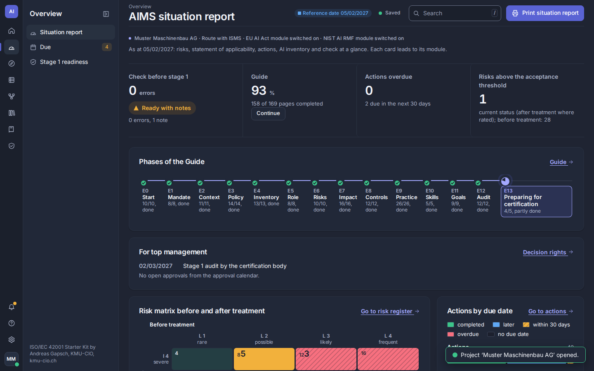
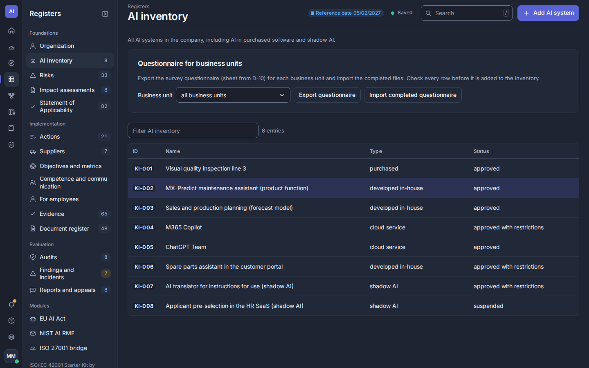
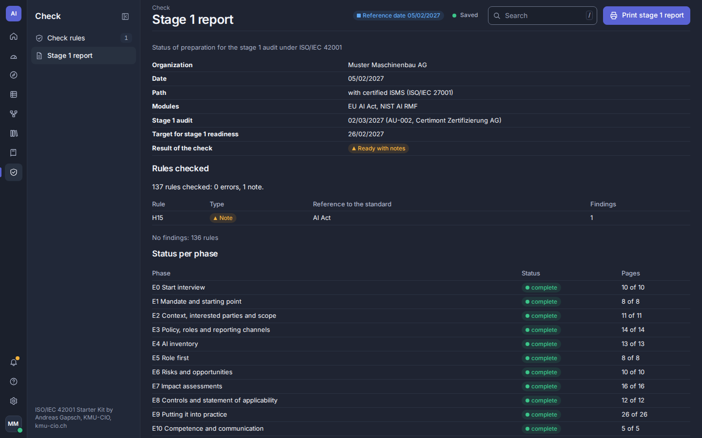
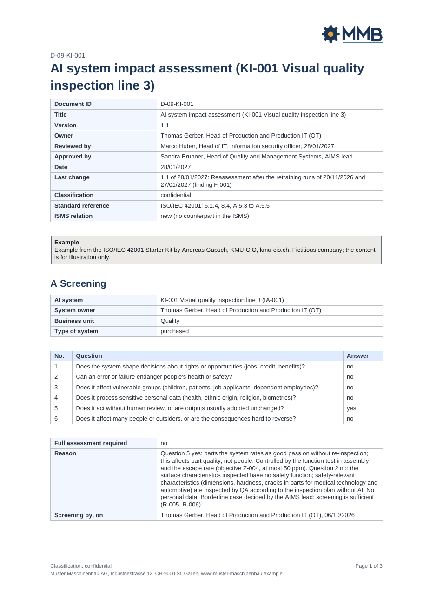

# ISO/IEC 42001 Starter Kit for SMEs

[](https://github.com/andreasgapsch/iso42001-starter-kit/actions/workflows/ci.yml)
[](LICENSE)
[](LICENSE-MIT)

[Deutsch](README.md) | English

With this kit, small and medium-sized enterprises build an AI management system (AIMS) under ISO/IEC 42001, with or without an existing ISMS under ISO/IEC 27001, up to stage 1 readiness. A guide, Word and Excel templates, a guided browser tool (AIMS Manager) and two completed examples work together. Everything runs offline, is available in German and English, contains no text of the standard (only clause numbers with its own short titles) and is free to use. By Andreas Gapsch, [KMU-CIO](https://kmu-cio.ch).

The current version is shown under [Releases](https://github.com/andreasgapsch/iso42001-starter-kit/releases).

## What it looks like

The screenshots show the ‘Muster Maschinenbau AG’ example (fictitious data, reference date 05/02/2027).

| | |
|---|---|
|  |  |
| Overview: status of the check, the guide, risks and actions at a glance (dark by default, light also available) | Register: AI inventory, risks, actions, suppliers and more |
|  |  |
| Check: stage 1 readiness with the rules checked | Documents: Word and Excel, generated from the project data |

More views: [start page](docs/bilder/en-01-start.png). The German screenshots in [docs/bilder](docs/bilder) also show the guide, the risk matrix, a process flow, the library, an Excel view and the phone layout.

## Get started in 5 minutes

1. Download the ZIP from [Releases](https://github.com/andreasgapsch/iso42001-starter-kit/releases) and unzip it.
2. Open `START.html` in your browser and start the AIMS Manager from there.
3. Open the ‘Muster Maschinenbau AG’ example and look around, or begin your own project. The guide leads you from the start interview onwards.

No installation, no account and no internet connection are needed. Edge or Chrome are recommended for the library folder.

## What the kit contains

| Part | Description |
|---|---|
| Guide | Roadmap in 10 steps, 90-day plan with an ISMS, 150-day plan without one, effort, common audit findings; poster ‘AIMS on one page’ (PDF, DE/EN) |
| Templates | D-00 to D-27 for Word and Excel, supplementary sheets for the path with an ISMS, optional EU AI Act module (E-01 to E-09) |
| NIST AI RMF module | optional: N-01 current and target profile (72 subcategories), N-02 coverage of AI RMF and ISO/IEC 42001, N-03 measurement and test concept, N-04 generative AI (12 risks according to NIST AI 600-1); additional RMF-xx controls in the statement of applicability, own check rules in the AIMS Manager. Voluntary framework, NIST does not certify |
| AIMS Manager | One HTML file that runs offline in the browser, with a guided mode, registers, processes, library, knowledge section, check and a document generator |
| Examples | Muster Maschinenbau AG (with an ISMS and the module) and Präzisionsteile GmbH (without an ISMS), each in DE and EN |
| AI assistant | Skill for Claude and ChatGPT/Codex with 12 modes (mode 12 NIST AI RMF, only with the module), plus a project instruction |
| Legal texts | EU AI Act, consolidated version of 27/07/2026, plus NIST AI 100-1, NIST AI 600-1 and the AI RMF Playbook (US government works), each with checksums (ZIP only) |

## Who it is for

- SMEs that already use AI or will soon, and want to build a management system under ISO/IEC 42001.
- People in charge of quality, IT, information security or data protection who lead the AIMS (the role ‘AIMS lead’).
- Consultants and auditors looking for an open, traceable model.

## The standard is not included

The kit contains no text of the standard. It names only clause and control numbers with its own short titles. Obtain ISO/IEC 42001 from SNV, DIN or ISO.

## Notes

- **No legal advice:** the kit is a practical aid. The EU AI Act classifications in the templates and examples are reasoned proposals and do not replace a legal review.
- **No warranty:** the kit is provided without any warranty of accuracy, completeness or fitness for a particular purpose (see the licences).
- **No promise of certification:** using the kit does not guarantee a passed audit or a certification.
- **No affiliation:** the kit is an independent project. It is not affiliated with, endorsed or reviewed by ISO, IEC, SNV, DIN or NIST.

## Quality

- **Gates:** on every push, CI checks types, unit and document tests, the kit build, the quality gates and the end-to-end tests in Chromium, Firefox and WebKit. The gates cover complete German and English texts, style, links and offline use, attribution, checksums of the legal texts, ID coverage, version and changelog, and the legal status.
- **Tests:** unit, document, end-to-end, skill and fuzz tests (inputs from files the AIMS Manager opens) run in CI.

## Build from source

Node.js 24 is required. The steps are in [CONTRIBUTING.md](CONTRIBUTING.md), section ‘Entwicklung’ (development).

```bash
npm ci
npm run kataloge && npm run schema
npm run build:app && npm run build:kit   # kit to dist/kit, ZIP to dist/
```

The legal texts (AI Act PDFs) and the comparison texts for the local check G6 are never part of the repository. Without them the kit is built without the legal texts folder.

## Contributing

Feedback is welcome: errors, unclear texts, experience from audits. Use the issue templates and do not attach confidential company data. Rules for contributions and releases are in [CONTRIBUTING.md](CONTRIBUTING.md), report security vulnerabilities as described in [SECURITY.md](SECURITY.md), and the history is in the [CHANGELOG](CHANGELOG.md).

## Licence

- Content (guide, templates, examples, texts): [CC BY 4.0](LICENSE)
- Programme code: [MIT](LICENSE-MIT)
- Additional permission: documents you create with the kit for your organization may be used without attribution ([additional permission](src/lizenz/ADDITIONAL-PERMISSION_EN.txt), [Zusatzerlaubnis](src/lizenz/ZUSATZERLAUBNIS_DE.txt)).

In full: [LICENCE.txt](src/lizenz/LICENCE.txt) and [LIZENZ.txt](src/lizenz/LIZENZ.txt). Attribution when passing on the kit: ‘ISO/IEC 42001 Starter Kit by Andreas Gapsch, KMU-CIO, kmu-cio.ch, CC BY 4.0’.
