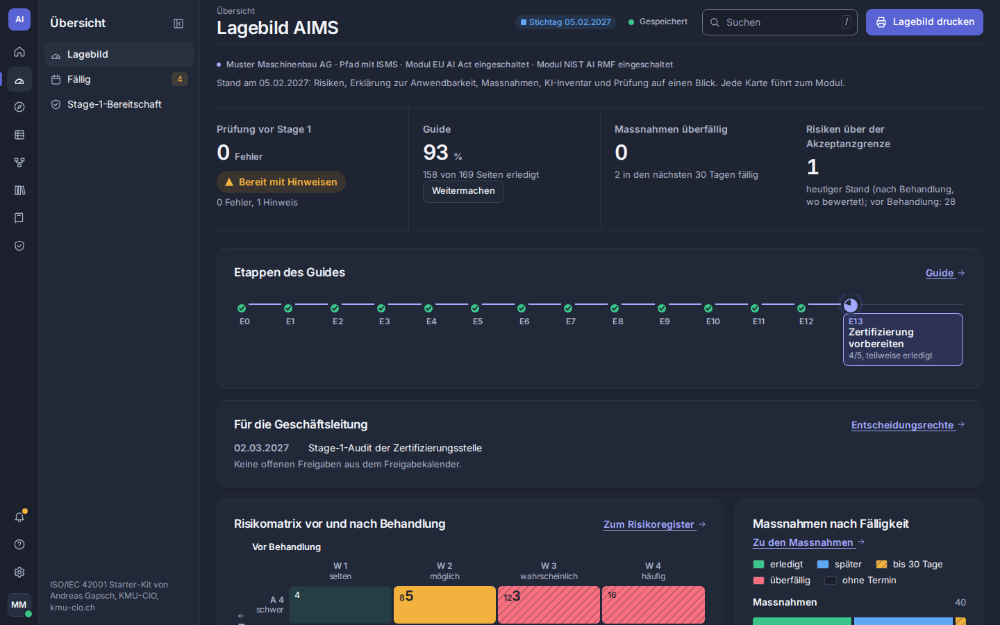
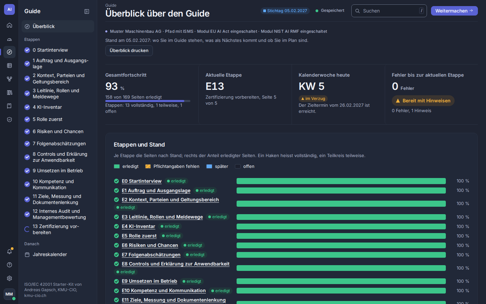
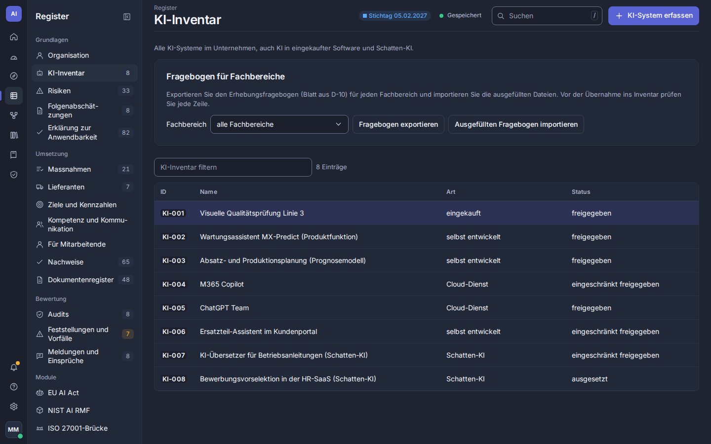
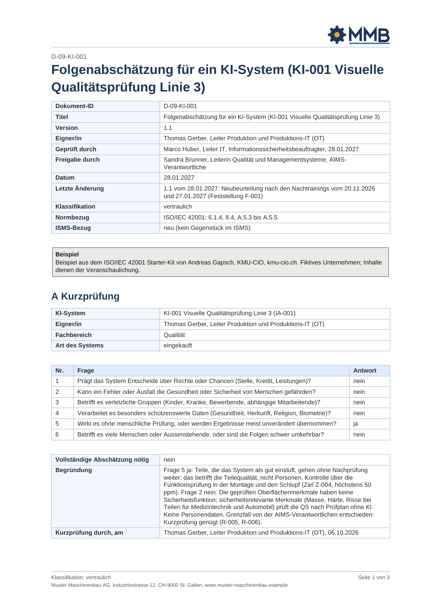

# ISO/IEC 42001 Starter-Kit für KMU

[](https://github.com/andreasgapsch/iso42001-starter-kit/actions/workflows/ci.yml)
[](LICENSE)
[](LICENSE-MIT)

Deutsch | [English](README.en.md)

Mit dem Kit bauen kleine und mittlere Unternehmen ein KI-Managementsystem (AIMS) nach ISO/IEC 42001 auf, mit oder ohne bestehendes ISMS nach ISO/IEC 27001, bis zur Bereitschaft für das Stage-1-Audit. Leitfaden, Word- und Excel-Vorlagen, ein geführter Browser-Werkzeugkasten (AIMS-Manager) und zwei ausgefüllte Beispiele greifen ineinander. Alles läuft offline, steht auf Deutsch und Englisch bereit und ist frei nutzbar. Von Andreas Gapsch, [KMU-CIO](https://kmu-cio.ch).

Die aktuelle Version steht bei den [Releases](https://github.com/andreasgapsch/iso42001-starter-kit/releases).

## So sieht es aus

Die Bilder zeigen das Beispiel «Muster Maschinenbau AG» (fiktive Daten, Stichtag 05.02.2027).

| | |
|---|---|
|  |  |
| Lagebild: Stand von Prüfung, Guide, Risiken und Massnahmen auf einen Blick (dunkel als Standard, auch hell) | Guide: führt Etappe für Etappe durch den Aufbau, mit Hilfe zu jeder Seite |
|  |  |
| Register: KI-Inventar, Risiken, Massnahmen, Lieferanten und mehr | Dokumente: Word und Excel, aus den Projektdaten erzeugt |

Weitere Ansichten:

- [Startseite](docs/bilder/de-01-start.png) und [Lagebild hell](docs/bilder/de-03-uebersicht-hell.png)
- [Risikomatrix](docs/bilder/de-06-risikomatrix.png) und [Stage-1-Bereitschaft](docs/bilder/de-07-pruefung-stage1.png)
- [Prozess mit Ablauf](docs/bilder/de-08-prozess-ablauf.png), [Bibliothek](docs/bilder/de-09-bibliothek.png) und [Excel-Ansicht](docs/bilder/de-11-excel-d11.png)
- Telefon: [Lagebild](docs/bilder/de-12-telefon-uebersicht.png) und [Register](docs/bilder/de-13-telefon-register.png)
- Englisch: [Start](docs/bilder/en-01-start.png), [Overview](docs/bilder/en-02-uebersicht-dunkel.png), [Register](docs/bilder/en-05-register-ki-systeme.png), [Stage 1](docs/bilder/en-07-pruefung-stage1.png), [Document](docs/bilder/en-10-document-d09.png)

## In 5 Minuten starten

1. Das ZIP unter [Releases](https://github.com/andreasgapsch/iso42001-starter-kit/releases) herunterladen und entpacken.
2. `START.html` im Browser öffnen und dort den AIMS-Manager starten.
3. Das Beispiel «Muster Maschinenbau AG» öffnen und umsehen, oder ein eigenes Projekt beginnen. Der Guide führt Sie ab dem Startinterview.

Es braucht keine Installation, kein Konto und keine Internetverbindung. Für den Bibliotheksordner sind Edge oder Chrome empfohlen.

## Inhalt des Kits

| Baustein | Beschreibung |
|---|---|
| Leitfaden | Fahrplan in 10 Schritten, 90-Tage-Plan mit ISMS, 150-Tage-Plan ohne ISMS, Aufwand, häufige Auditfeststellungen; Poster «AIMS auf einer Seite» (PDF, DE/EN) |
| Vorlagen | D-00 bis D-27 für Word und Excel, Ergänzungsblätter für den Pfad mit ISMS, optionales Modul EU AI Act (E-01 bis E-09) |
| Modul NIST AI RMF | optional: N-01 Profil Ist und Ziel (72 Subkategorien), N-02 Abdeckung AI RMF und ISO/IEC 42001, N-03 Mess- und Prüfkonzept, N-04 generative KI (12 Risiken nach NIST AI 600-1); Zusatz-Controls RMF-xx in der Erklärung zur Anwendbarkeit, eigene Prüfregeln im AIMS-Manager. Freiwilliges Rahmenwerk, NIST zertifiziert nicht |
| AIMS-Manager | Eine HTML-Datei, läuft offline im Browser. Navigation mit Symbolleiste und Untermenü (Designpaket «AIMS Nachtblau», dunkel als Standard): Start, Übersicht, Guide, Register, Prozesse, Bibliothek, Wissen (Leitfaden, Regelwerke, Glossar), Prüfung, globale Suche, Dokumentengenerator |
| Beispiele | Muster Maschinenbau AG (mit ISMS und Modul) und Beispiel Präzisionsteile GmbH (ohne ISMS), je DE und EN |
| KI-Assistent | Skill für Claude und ChatGPT/Codex mit 12 Modi (Modus 12 NIST AI RMF, nur mit Modul), dazu eine Projektanweisung |
| Rechtstexte | EU AI Act, konsolidierte Fassung vom 27.07.2026, sowie NIST AI 100-1, NIST AI 600-1 und AI RMF Playbook (Werke der US-Regierung), je mit Prüfsummen (nur im ZIP) |

Was das Kit auszeichnet: Schweizer Blick, Deutsch und Englisch, mit oder ohne ISMS, offline, ohne Normtext (nur Abschnittsnummern mit eigenen Kurztiteln), frei unter CC BY 4.0.

## Für wen

- KMU, die KI bereits einsetzen oder bald einsetzen und ein Managementsystem nach ISO/IEC 42001 aufbauen wollen.
- Verantwortliche für Qualität, IT, Informationssicherheit oder Datenschutz, die das AIMS führen (die Rolle «AIMS-Verantwortliche/r»).
- Beratende und Auditierende, die ein offenes, nachvollziehbares Muster suchen.

### Kit oder Plattform?

| Frage | Kit | Plattform für Laufzeitschutz und Überwachung |
|---|---|---|
| Managementsystem, Rollen, Risiken, Nachweise für das Audit | ja, vollständig | meist nur teilweise |
| Laufende technische Kontrolle von KI-Aufrufen (Filter, Protokolle, Kostendach) | Regeln und Prüffragen, keine Technik | ja |
| Wann nötig | ab dem ersten KI-System | erst bei vielen Nutzenden, Agenten mit Schreibrechten oder vertraulichen Daten im grossen Stil |

## Die Norm ist nicht enthalten

Das Kit enthält keinen Normtext. Es nennt nur Abschnitts- und Control-Nummern mit eigenen Kurztiteln. ISO/IEC 42001 ist bei SNV, DIN oder ISO zu beziehen.

## Hinweise

- **Keine Rechtsberatung:** Das Kit ist eine fachliche Arbeitshilfe. Die Einstufungen nach dem EU AI Act in Vorlagen und Beispielen sind begründete Vorschläge und ersetzen keine juristische Prüfung.
- **Keine Gewähr:** Das Kit wird ohne Gewähr für Richtigkeit, Vollständigkeit oder Eignung für einen bestimmten Zweck bereitgestellt (siehe Lizenzen).
- **Keine Zertifizierungszusage:** Die Nutzung des Kits garantiert kein bestandenes Audit und keine Zertifizierung.
- **Keine Verbindung:** Das Kit ist ein unabhängiges Projekt und steht in keiner Verbindung zu ISO, IEC, SNV, DIN oder NIST und wird von ihnen weder unterstützt noch geprüft.

## Qualität

- **Tore:** Bei jedem Push prüft CI Typen, Unit- und Dokumententests, den Kit-Build, die Qualitätstore und die E2E-Tests in Chromium, Firefox und WebKit. Die wichtigsten Tore: G4 Texte in DE und EN vollständig, G5 Stil (Schweizer Rechtschreibung, keine Gedankenstriche), G6 keine Wortfolgen aus Normen oder fremden Vergleichstexten (nur lokal), G7 Links und offline, G8 Namensnennung im Kit und keine in erzeugten Dokumenten, G14 Prüfsummen der Rechtstexte, G15 ID-Abdeckung von Anforderungen und Controls, G18 wörtliche NIST-Zitate Wort für Wort gegen die PDFs (nur lokal), G36 Version und Changelog, G37 Rechtsstand.
- **Tests:** Unit-, Dokumenten-, E2E-, Skill- und Fuzz-Tests (Eingaben aus Dateien, die der AIMS-Manager öffnet) laufen in CI.

## Aus den Quellen bauen

Voraussetzung ist Node.js 24. Die Schritte stehen in [CONTRIBUTING.md](CONTRIBUTING.md), Abschnitt «Entwicklung».

```bash
npm ci
npm run kataloge && npm run schema
npm run build:app && npm run build:kit   # Kit nach dist/kit, ZIP nach dist/
```

Die Rechtstexte (AI-Act-PDFs) und die Vergleichstexte für die lokale Prüfung G6 liegen nie im Repo. Ohne sie baut das Kit ohne den Ordner Rechtstexte.

## Aufbau des Repos

| Ordner | Inhalt |
|---|---|
| `src/i18n/de`, `src/i18n/en` | Alle Texte (Vorlagen, Werkzeug, Guide, Leitfaden) |
| `src/kataloge`, `src/ai-act`, `src/nist-rmf` | Kataloge: Anforderungen und Controls 42001, 27001, Mapping, AI-Act-Pflichten, Zusatz-Controls, NIST AI RMF (Subkategorien, RMF-Controls, GenAI-Risiken, Stand) |
| `src/vorlagen` | Vorlagen als TypeScript-Funktionen, ein Generator für Word und Excel (`src/generator`) |
| `src/model` | Datenmodell der Projektdatei, daraus JSON Schema und Validator |
| `src/app` | AIMS-Manager (Preact, Vite, eine Datei) |
| `src/gefuehrt`, `src/regeln` | Etappen und Seiten des Guide, Prüfregeln, Stimmigkeitsprüfung der Beispiele |
| `src/beispiele` | Beispielprojekte und deren Aufbau |
| `src/skill`, `src/leitfaden`, `src/start`, `src/lizenz` | KI-Assistent, Leitfaden, Startseite, Lizenztexte |
| `scripts` | Build, Prüfskripte (Qualitätstore), Hilfswerkzeuge (auch die Bildschirmfotos: `npm run bildschirmfotos`) |
| `tests` | Unit-, Dokumenten-, E2E- und Skill-Tests |
| `docs` | Konventionen, Architektur, Design-System, Hinweise zur Entwicklung, Bilder |
| `spikes` | Technische Vorabklärungen aus der Planung |

## Mitwirken

Rückmeldungen sind willkommen: Fehler, unklare Texte, Erfahrungen aus Audits. Nutzen Sie die Issue-Vorlagen und hängen Sie keine vertraulichen Firmendaten an. Regeln für Beiträge und für den Release stehen in [CONTRIBUTING.md](CONTRIBUTING.md), Sicherheitslücken melden Sie gemäss [SECURITY.md](SECURITY.md), den Verlauf finden Sie im [CHANGELOG](CHANGELOG.md).

## Lizenz

- Inhalte (Leitfaden, Vorlagen, Beispiele, Texte): [CC BY 4.0](LICENSE)
- Programmcode: [MIT](LICENSE-MIT)
- Zusatzerlaubnis: Dokumente, die Sie mit dem Kit für Ihre Organisation erstellen, dürfen Sie ohne Namensnennung verwenden ([Zusatzerlaubnis](src/lizenz/ZUSATZERLAUBNIS_DE.txt), [Additional permission](src/lizenz/ADDITIONAL-PERMISSION_EN.txt)).

Ausführlich: [LIZENZ.txt](src/lizenz/LIZENZ.txt) und [LICENCE.txt](src/lizenz/LICENCE.txt). Namensnennung beim Weitergeben des Kits: «ISO/IEC 42001 Starter-Kit von Andreas Gapsch, KMU-CIO, kmu-cio.ch, CC BY 4.0».

---

## English summary

A free kit that helps small and medium-sized enterprises build an AI management system (AIMS) under ISO/IEC 42001, with or without an existing ISMS under ISO/IEC 27001, up to stage 1 readiness. Full English version: [README.en.md](README.en.md).
